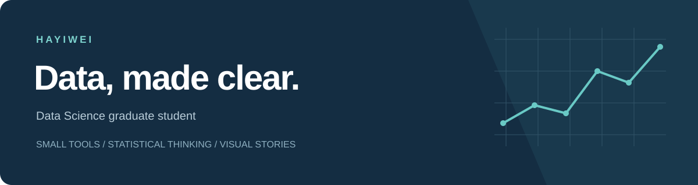

I'm a **Data Science graduate student** building small tools to explore datasets
and communicate results.

I enjoy the practical side of working with data: asking a clear question,
checking the details, and making the result easy to understand.

### Selected projects

<table>
<tr>
<td width="50%" valign="top">
<h3><a href="https://github.com/Hayiwei/csv-lens">CSV Lens</a></h3>

A useful first look at a CSV: completeness, duplicate rows, column exploration, and a downloadable report.

<code>Python</code> <code>pandas</code> <code>Streamlit</code>

</td>
<td width="50%" valign="top">
<h3><a href="https://github.com/Hayiwei/data-viz-gallery">Data Viz Gallery</a></h3>

Six reproducible chart recipes with a consistent visual style, documented synthetic data, and PNG/SVG exports.

<a href="https://hayiwei.github.io/data-viz-gallery/">Browse the live gallery →</a>

<code>Python</code> <code>Matplotlib</code> <code>NumPy</code>

</td>
</tr>
</table>

### Interests

Exploratory data analysis · Statistical thinking · Data visualization · Useful Python tools

### In this collection

- Small projects with a clear purpose.
- Examples that run without API keys.
- Documented data, readable code, and reproducible outputs.

Explore the repositories, try an example, or open an issue with a suggestion.
